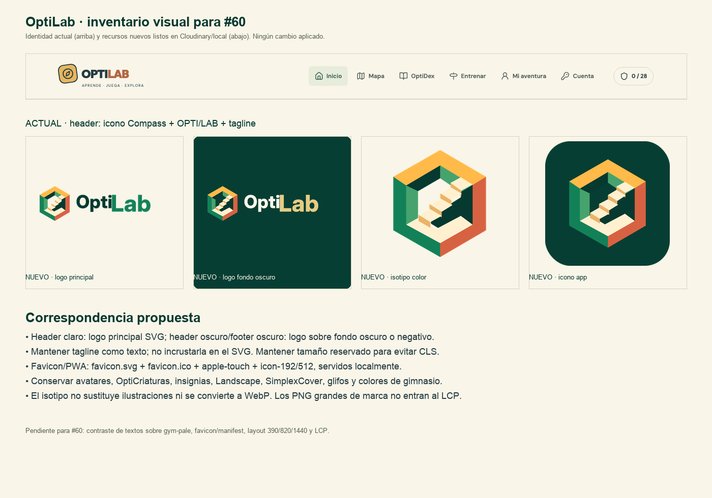

# OptiLab · inventario visual y correspondencia para #60

Estado: propuesta de revisión. No se modificó la interfaz. Base: `5318040` (main con #58) más la infraestructura de #59.

## 1. Resumen ejecutivo

La identidad visible actual no usa el Brand Kit nuevo: el header construye una marca con un icono `Compass` de Lucide dentro de un cuadrado ámbar inclinado, el texto `OPTI`/`LAB` y una tagline. El sitio no tiene favicon, Apple Touch Icon, manifest PWA ni enlaces a los SVG nuevos.

El Brand Kit aporta un sistema de arquitectura/isótopo y logotipo. La recomendación es sustituir solo la capa de marca (header, footer, favicon/PWA y metadatos) y conservar las ilustraciones, avatares, criaturas, insignias, portadas y colores de gimnasio que ya forman parte de la experiencia.

Referencias del estado actual:

- `docs/brand-audit/current-header-1440.png`
- `docs/brand-audit/current-header-390.png`
- `docs/brand-audit/current-home-1440.png`
- `docs/brand-audit/current-home-390.png`

## 2. Inventario de marca y logos

| Elemento | Estado actual | Fuente | Uso | Acción propuesta |
| --- | --- | --- | --- | --- |
| Marca del header | `Compass` Lucide + cuadrado ámbar + texto OPTI/LAB + tagline | `src/components/SiteHeader.tsx:4`, `.brand`/`.brand-symbol` en `src/styles.css` | Header en todas las rutas | Reemplazar por SVG nuevo; conservar tagline como texto |
| Marca del footer | Texto `OPTILAB` + “Un pequeño juego. Una gran idea.” | `src/App.tsx:130`, `.footer-brand` | Footer global | Usar logotipo SVG o marca compacta; mantener la frase como texto |
| Favicon | No existe `<link rel="icon">` | `index.html` | Navegador | Añadir `favicon.svg` y `favicon.ico` en #60 |
| Apple Touch Icon | No existe | `index.html` | iOS | Añadir `apple-touch-icon.png` en #60 |
| Manifest PWA | No existe | `public/` | Instalación PWA | Crear manifest con 192/512 y colores nuevos |
| `theme-color` | `#172f37` | `index.html` | Barra del navegador | Evaluar `#073E33` en #60 con contraste real |
| Icono de app | No hay app instalable; sí iconos nuevos 1024 | `public/brand/app-icons/` | Futuro icono de tienda/PWA | Usar como fuente; no aplicarlo aún |
| Avatar social | No hay imagen social enlazada | `brand-assets.json: avatar-social` | Futuro Open Graph/social | Usar variante Cloudinary cuando se defina metadata |
| Logotipos vectoriales nuevos | 8 SVG listos | `public/brand/svg/` | Header/footer/documentación | Usar SVG; no convertir a WebP |
| PWA nuevo | 5 archivos listos | `public/brand/pwa/` | Navegador/PWA | Enlazar en #60; no duplicar en CDN |

### Correspondencia recomendada de logotipos

| Superficie | Recurso nuevo | Regla |
| --- | --- | --- |
| Header sobre crema | `optilab-logo-principal.svg` | SVG, altura reservada; tagline separada |
| Header/footer sobre verde oscuro | `optilab-logo-sobre-fondo-oscuro.svg` | Solo sobre `#073E33` o fondo oscuro equivalente |
| Fondo oscuro arbitrario | `optilab-logo-negativo.svg` | Transparente; no usar sobre fondos claros |
| Footer compacto | `optilab-logotipo-color.svg` | Solo nombre; reduce altura |
| Isotipo solo | `optilab-isotipo-color.svg` o `isotipo-monocromo` | No sustituye ilustraciones ni avatares |
| Icono de app/PWA | `optilab-icono-app.svg` + `icon-192/512.png` | 192/512 locales para PWA |
| Favicon | `favicon.svg` + `favicon.ico` | Ambos locales; el ICO contiene tamaños pequeños |
| Social | `avatar-social` | Cloudinary; no es un recurso del header |

## 3. Ilustraciones y elementos gráficos actuales

| Familia | Elementos | Fuente | Decisión |
| --- | --- | --- | --- |
| Mascotas / OptiCriaturas SVG | Nexo, Poli, Piv, Dua, Brío (fallback vectorial) | `src/Art.tsx` (`Mascot`) | Conservar |
| Insignias SVG fallback | 5 símbolos de gimnasio | `src/Art.tsx` (`Badge`) | Conservar como fallback |
| Paisaje del hero | Sol, montañas, escuela, árboles | `src/Art.tsx` (`Landscape`) | Conservar |
| Portadas Simplex | Memorama, Rompecabezas, Ahorcado, Ordena, Caza el pivote | `src/components/SimplexCover.tsx` | Conservar; no reemplazar por logo |
| Glifos de cartucho | `◈ ⌘ ⊞ ⟷ △` para juegos no Simplex | `src/components/GameCard.tsx:39` | Conservar o revisar en #60 |
| Mapa | Ruta CSS, islas, números, brújula | `src/styles.css`, `src/pages/GymMap.tsx` | Conservar; probar contraste |
| Iconos de navegación/UI | Home, Map, BookOpen, Signpost, UserRound, KeyRound, Shield, Compass, Trophy, Sparkles, etc. | Lucide | Conservar como iconos funcionales |
| Marca de agua/portada de clase | `class-cover` | `src/activities/external.css` | Conservar |

## 4. Raster existente en Cloudinary

El proyecto ya usa Cloudinary para ilustraciones grandes mediante `AssetImage`, con `srcset`, `c_limit`, `q_auto:good` y `f_auto`:

| Grupo | Cantidad | IDs / observación | Fuente |
| --- | ---: | --- | --- |
| Avatares | 6 | `avatar-01`…`avatar-06` (Kai, Mika, Ares, Lyra, Zane, Nova) | `src/data/avatars.ts` |
| OptiCriaturas | 15 | `nexo`, `poli`, `piv`, `dua`, `brio` × etapas 1–3 | `src/data/companions.ts` |
| Insignias | 9 | `badge-01`…`badge-09` | `src/data/badges.ts` |
| Nuevos recursos de marca | 14 | `optilab/brand/*` | `brand-assets.json` |

No se deben sustituir avatares, criaturas ni insignias por el isotipo. Tampoco se deben volver a subir: ya tienen URLs estables y `AssetImage` ya resuelve responsive.

## 5. Colores y tipografía

### Tokens actuales

| Token | Hex | Uso |
| --- | --- | --- |
| `--ink` | `#243b40` | Texto y bordes |
| `--green` | `#315e4e` | CTA, enlaces y acentos |
| `--coral` | `#ba604a` | Marca “LAB” y acentos |
| `--cream` | `#f9f5e9` | Fondo principal |
| `--theme-color` | `#172f37` | Barra del navegador |

### Paleta nueva

`#06392F` ink · `#138158` verde marca · `#46A36D` verde claro · `#FFBA49` ámbar · `#D76242` coral · `#F9F5E9` crema · `#073E33` verde oscuro.

### Correspondencia propuesta

| Actual | Nuevo | Regla |
| --- | --- | --- |
| `#f9f5e9` | `#F9F5E9` | Igual; conservar |
| `#243b40` | `#06392F` | Solo tinta de marca/superficies; validar texto fino |
| `#315e4e` | `#06392F` / `#138158` | CTA principal oscuro; `#138158` no usar en texto pequeño sobre crema (4.47:1) |
| `#ba604a` | `#D76242` | Acento decorativo; no texto normal (3.37:1 sobre crema) |
| `#172f37` | `#073E33` | Candidato a `theme-color`; probar navegador real |
| Colores de gimnasio | Conservar | Identifican los cinco gimnasios; no son tokens de marca |

Contrastes relevantes: `#06392F`/crema 11.79:1; `#073E33`/crema 11.03:1; `#FFBA49`/`#073E33` 7.09:1; `#D76242`/crema 3.37:1; `#46A36D`/crema 2.87:1. Los acentos de gimnasio sobre su `pale` están entre 3.14:1 y 3.63:1: revisar textos pequeños en #60.

### Tipografía

- UI actual: `DM Sans` (cuerpo) y `Outfit` (títulos).
- El logotipo nuevo ya está convertido a paths; no requiere Inter Display ni una fuente nueva.
- Mantener Outfit/DM Sans en #60 para no introducir una regresión tipográfica.

## 6. Reglas para #60

1. Header: usar SVG local con `width`/`height` explícitos y altura reservada. No cargar el PNG de 2048 como LCP.
2. Footer: SVG o logotipo compacto; conservar la frase y el contraste.
3. Favicon/PWA: enlazar `public/brand/pwa/*` y crear manifest; usar `import.meta.env.BASE_URL`.
4. Imágenes grandes: seguir usando Cloudinary con `f_auto,q_auto`, `srcset`, `sizes` y `c_limit`; no convertir SVG a WebP.
5. No precargar todos los recursos. Mantener `priority/eager` solo donde ya está el LCP actual (hero y primera isla del mapa).
6. Respetar `prefers-reduced-motion`; no añadir animaciones al logo.
7. Conserved avatares, criaturas, insignias, paisaje, portadas, glifos y colores de gimnasio.
8. Validar 390/820/1440, teclado, axe, contraste, CLS y LCP antes de cerrar #60.

## 7. Evidencia y límites

- Capturas actuales: `docs/brand-audit/current-header-1440.png`, `current-header-390.png`, `current-home-1440.png`, `current-home-390.png`.
- Mapa visual: `docs/brand-audit/brand-map.png`.
- No se modificaron `src/`, `index.html`, `public/` (salvo los assets nuevos de #59), dashboard, ranking, navegación móvil, juegos ni backend.
- No se re-subieron ni regeneraron recursos de Cloudinary para este inventario.
